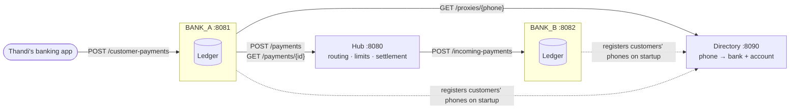
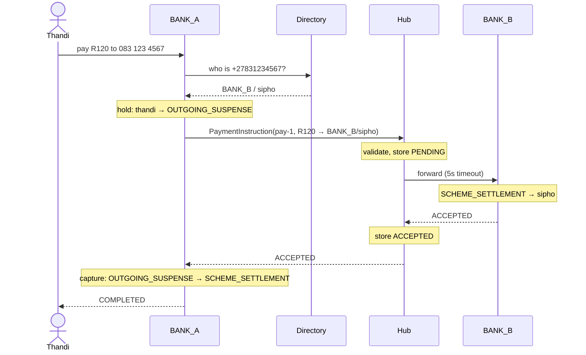
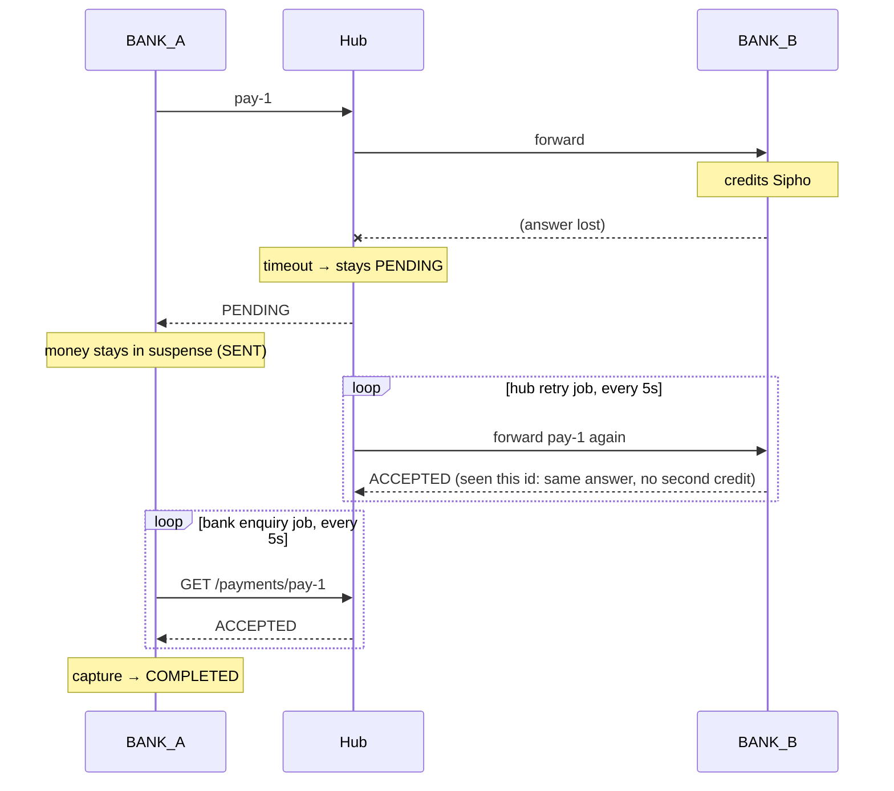

# PayPen

A small, working model of a real-time payment scheme in the style of South Africa's PayShap:
two banks, a central hub, and a phone-number directory, each a separate service. You can pay
someone by phone number, watch the money move through double-entry ledgers, then break
things on purpose (slow banks, lost responses, frozen accounts) and see that no money is ever
created, lost, or paid twice.

It's a learning project. It is not affiliated with PayShap, its operator, or any bank, and
it doesn't implement the real scheme's messages or rules.

## What is PayShap?

PayShap is South Africa's rapid payments service, launched in 2023 as part of the Rapid
Payments Programme led by the South African Reserve Bank and the Payments Association of
South Africa, and operated by BankservAfrica (now PayInc). It lets someone at one bank pay
someone at another bank **instantly, 24/7**, and pay them by a **ShapID**, a proxy such as a
mobile number, instead of an account number and branch code. Each payment has a
per-transaction limit (R3,000 at launch).

To make that work, a scheme needs the same pieces PayPen models:

- a **directory** that turns a phone number into "bank X, account Y"
- a **hub** that every bank connects to, which routes each payment to the right bank, sets the
  rules (such as the limit), and keeps track of what the banks owe each other
- **banks** that hold their customers' money in a ledger, send payments, and credit incoming ones

## Architecture



### The happy path: Thandi pays Sipho R120



### When a response is lost

The hard case: BANK_B credits Sipho, but its answer never reaches the hub. Nobody upstream
knows whether Sipho was paid. Refunding Thandi would pay out the money twice; capturing it
blindly could take her money for a payment that didn't happen. So nobody guesses.



## Project structure

```
PayPen/
├── settings.gradle.kts          ← lists the modules
├── build.gradle.kts             ← shared config: Java 21, JUnit, Spring Boot version
├── gradlew, gradle/wrapper/     ← Gradle wrapper (no local Gradle needed)
├── .github/workflows/ci.yml     ← runs every test on every push
├── Dockerfile                   ← one image recipe for every service
├── docker-compose.yml           ← runs all four services (+ Prometheus with --profile metrics)
├── demo.sh                      ← scripted tour of the happy path and failures
├── ledger/                      ← double-entry ledger, plain Java, no Spring
├── common/                      ← messages shared by hub and banks (PaymentInstruction, PaymentResult)
├── directory/                   ← Spring Boot: phone number → bank + account
├── hub/                         ← Spring Boot: routing, limits, status enquiry, settlement
├── bank/                        ← Spring Boot: accounts, outgoing and incoming payments, admin/chaos
└── integration-tests/           ← starts all four services in one JVM and runs every scenario
```

`ledger/CONCURRENCY_NOTES.md` describes how the ledger was made thread-safe: what broke
without locks, and why lock order matters.

## Running it

### With Docker

```bash
docker compose up --build
```

That builds the code inside Docker (no local Java needed) and starts:

| Service   | URL                   |
|-----------|-----------------------|
| hub       | http://localhost:8080 |
| BANK_A    | http://localhost:8081 |
| BANK_B    | http://localhost:8082 |
| directory | http://localhost:8090 |

The services can start in any order: banks keep retrying their phone registrations until the
directory is up. Stop with Ctrl+C. All data is in memory, so every start begins fresh.

### Without Docker

Needs Java 21.

```bash
./gradlew bootJar
java -jar directory/build/libs/directory-0.1.0-SNAPSHOT.jar
java -jar hub/build/libs/hub-0.1.0-SNAPSHOT.jar
java -jar bank/build/libs/bank-0.1.0-SNAPSHOT.jar                                  # BANK_A
java -jar bank/build/libs/bank-0.1.0-SNAPSHOT.jar --spring.profiles.active=bank-b  # BANK_B
```

Run each `java -jar` in its own terminal.

### The demo

With everything running:

```bash
./demo.sh
```

It pays Thandi → Sipho, then walks through a duplicate, an unknown number, insufficient funds,
a frozen payee, the scheme limit, and a lost response, printing balances along the way and
finishing with the settlement report and a check that every ledger sums to zero. It only needs
`bash` and `curl`.

### Seed data

| Bank   | Customer | Phone        | Opening balance |
|--------|----------|--------------|-----------------|
| BANK_A | thandi   | 082 123 4567 | R500            |
| BANK_A | lerato   | 072 123 4567 | R300            |
| BANK_A | zanele   | 084 123 4567 | R50 (frozen)    |
| BANK_B | sipho    | 083 123 4567 | R250            |
| BANK_B | bongani  | 073 123 4567 | R100 (frozen)   |

### Try it by hand

```bash
# Thandi pays Sipho R120
curl -H 'Content-Type: application/json' localhost:8081/customer-payments \
  -d '{"paymentId":"pay-1","fromAccount":"thandi","toPhone":"0831234567","amountCents":12000}'

curl localhost:8081/accounts/thandi        # balance and every entry
curl localhost:8082/admin/ledger           # every account at BANK_B; total is always 0
curl localhost:8080/payments/pay-1         # the hub's status enquiry
curl localhost:8080/settlement             # "BANK_A owes BANK_B R120.00"
```

### Tests

```bash
./gradlew test
```

Runs the unit tests for each module and `integration-tests`, which starts the directory, hub
and both banks as real servers and runs every scenario below. After each scenario it checks
the books: every ledger sums to zero, nothing is left in suspense, the two banks'
`SCHEME_SETTLEMENT` balances mirror each other, and both match the hub's settlement report.
CI runs the same command on every push.

### Metrics

Every service exposes `/actuator/health` and `/actuator/prometheus`. To scrape them:

```bash
docker compose --profile metrics up --build
```

Then open Prometheus at http://localhost:9090 and try:

| Question | Query |
|---|---|
| Payments per second through the hub | `rate(paypen_hub_payments_received_total[1m])` |
| Rejections, by who rejected | `sum by (rejected_by) (rate(paypen_hub_payments_decided_total{status="REJECTED"}[5m]))` |
| Payee bank latency, 95th percentile | `histogram_quantile(0.95, sum by (le, bank) (rate(paypen_hub_payee_latency_seconds_bucket[5m])))` |
| Payee bank timeouts | `rate(paypen_hub_payee_timeouts_total[5m])` |
| Customer payment outcomes per bank | `sum by (bank, status) (rate(paypen_bank_customer_payments_total[5m]))` |
| Customer-facing latency | `histogram_quantile(0.95, sum by (le, bank) (rate(paypen_bank_customer_payment_latency_seconds_bucket[5m])))` |

## API

| Service | Endpoint | Purpose |
|---|---|---|
| directory | `POST /proxies` | Register `{phone, bankCode, accountId}`; 409 if taken, 400 if not a valid SA mobile number |
| directory | `GET /proxies/{phone}` | Resolve a number; 404 if unknown |
| hub | `POST /payments` | Validate, forward to the payee bank, return ACCEPTED / REJECTED / PENDING |
| hub | `GET /payments/{id}` | Status enquiry: what actually happened to this payment? |
| hub | `GET /settlement[?date=YYYY-MM-DD]` | Net positions and who owes whom for a day |
| bank | `POST /customer-payments` | A customer pays a phone number |
| bank | `GET /customer-payments/{id}` | Status of an outgoing payment |
| bank | `POST /incoming-payments` | Called by the hub to credit a customer |
| bank | `GET /accounts/{id}` | Balance and every entry |
| bank | `POST /admin/accounts/{id}/freeze`, `/unfreeze` | Freeze or unfreeze an account |
| bank | `POST /admin/accounts/{id}/deposit` | Add money from FUNDING, `{amountCents}` |
| bank | `GET /admin/ledger` | Every balance and the total (always 0) |
| bank | `PUT /admin/chaos` | `{"mode": "SLOW" \| "DROP_RESPONSE" \| "NONE", "delayMs": 8000}` |

Amounts are always integer cents: `12000` is R120.00.

## Failure scenarios

Each one is an end-to-end test in `integration-tests/`.

| Scenario | What happens | Customer sees | Money |
|---|---|---|---|
| Happy path | Hold, send, payee credits, capture | COMPLETED | Payer −R120, payee +R120 |
| Unknown number | Directory has no such number; stopped before any hold | REJECTED | Nothing moves |
| Insufficient funds | The ledger refuses the hold | REJECTED | Nothing moves |
| Frozen payer | The bank refuses before the hold | REJECTED | Nothing moves |
| Frozen payee | Held and sent; payee bank says REJECTED | REFUNDED | Held, then returned |
| Over the scheme limit | Held and sent; hub says REJECTED | REFUNDED | Held, then returned |
| Payee bank down | Hub can't connect, so the bank certainly never got it | REFUNDED | Held, then returned |
| Duplicate instruction | Same `paymentId` sent again to the bank, hub, or payee bank | The original answer | Moved once |
| Slow payee bank | The paying bank times out first, asks the hub, captures once the hub knows | SENT, then COMPLETED | Held until the outcome is known |
| Lost response | Payee credits, answer lost; hub stays PENDING and retries; paying bank keeps asking | SENT, then COMPLETED | Held until the outcome is known; credited once |

## Design decisions

**Double-entry.** Every transaction is a set of entries that must sum to exactly zero, so money
only ever moves between accounts. It can't appear or vanish because of a bug, only be in the
wrong account, and a wrong account is something you can find. Every step of a payment is
an ordinary transfer:

| Event | From | To |
|---|---|---|
| Opening balance | FUNDING | customer |
| Hold funds before sending | customer | OUTGOING_SUSPENSE |
| Payment accepted | OUTGOING_SUSPENSE | SCHEME_SETTLEMENT |
| Payment failed, refund | OUTGOING_SUSPENSE | customer |
| Money received | SCHEME_SETTLEMENT | customer |

Mistakes are never edited: `reverse(txId)` posts the opposite transaction, so the history shows
both the mistake and the fix.

**Suspense accounts.** Between "Thandi pressed pay" and "BANK_B confirmed", the money belongs to
nobody yet. Taking it out of Thandi's account straight away stops her spending it twice;
keeping it in `OUTGOING_SUSPENSE`, not yet in `SCHEME_SETTLEMENT`, means the bank hasn't
promised it to anyone. The suspense balance always equals "payments we're still waiting to
hear about". Anything stuck there is visible and can be found by a query.

**Settlement accounts.** `SCHEME_SETTLEMENT` is the bank's running position with the rest of the
scheme. Because both banks book the same payment from opposite sides, BANK_A's balance and
BANK_B's always cancel out, and they match the hub's settlement report. That cross-check is what
catches a lost-response bug: in testing, a deliberately broken "refund on timeout" left each
bank's own ledger perfectly balanced, and only the cross-bank comparison showed the R120 that
had been paid out twice.

**Idempotency keys.** Networks fail in the worst place: after the work is done but before the
answer arrives. So every payment carries a `paymentId` chosen by the sender, and every party
(paying bank, hub, payee bank) treats a repeated id as the same payment and repeats its original
answer. That makes retrying always safe, and retrying is how every lost response gets
recovered. A repeat gets the original answer, not "REJECTED: duplicate", because a retry that
hears "rejected" would refund a customer who was in fact paid.

**Never guess on a timeout.** A timeout means "I don't know", not "it failed". The bank only
refunds when it knows nobody was credited: the payee rejected it, the hub rejected it, or the hub
couldn't even be connected to. Otherwise it asks the hub (`GET /payments/{id}`), and a scheduled
job keeps asking until there's an answer. Timeouts are layered so the bank (10s) waits longer
than the hub waits for a payee bank (5s), so normally the hub answers PENDING rather than
leaving the bank to time out.

**Integer cents (`long`).** `0.1 + 0.2 != 0.3` in floating point, and a ledger that must sum to
exactly zero can't afford rounding. A `long` of cents is exact, fast, and covers far more money
than exists. `BigDecimal` would also be exact, but is slower and easier to misuse
(`new BigDecimal(0.1)`, `equals` vs `compareTo`).

**Per-account locks in a fixed order.** Transfers on unrelated accounts run in parallel; a
transfer locks the accounts it touches, always sorted by id, so two opposite transfers can never
deadlock. See `ledger/CONCURRENCY_NOTES.md`.

## Known limitations

- **Everything is in memory.** Restarting a service loses its ledger, payments, and directory. A
  real system needs durable storage, and the hold/send/capture steps would need to survive a
  crash halfway through (an outbox or a write-ahead log).
- **No authentication.** Anyone who can reach a service can call it, including `/admin` and
  `/admin/chaos`. Any bank can register any phone number in the directory.
- **Single instance per service.** Locks and the retry and enquiry jobs assume one copy of each
  service; running two would need distributed locking or a database to coordinate.
- **Settlement is a report, not a movement of money.** Real schemes settle between banks'
  accounts at the central bank; here the report only says who owes whom.
- **Simplified messages.** Real schemes use ISO 20022 messages, reason codes, and much stricter
  validation. Rejection reasons here are free text.
- **"Never arrived" is a heuristic.** If the hub has no record of a payment 60 seconds after it
  was sent, the bank refunds it. A request delayed longer than that could still, in theory,
  arrive later.
- **No timeouts on directory calls.** A hung directory would make a customer payment hang.
- **Unknown outcomes are retried forever.** A payment stuck in PENDING or SENT is retried every
  5s with no back-off, alerting, or manual override.
- **No customer view of a payee's name.** Real apps show "You're paying S. Dlamini" before
  confirming; this returns the account id after the payment.
